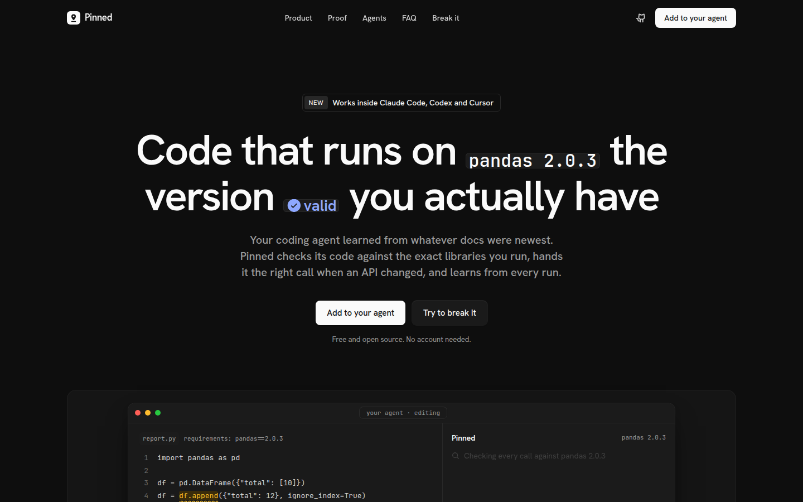
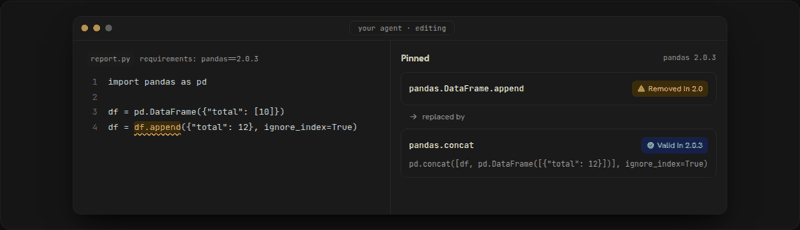
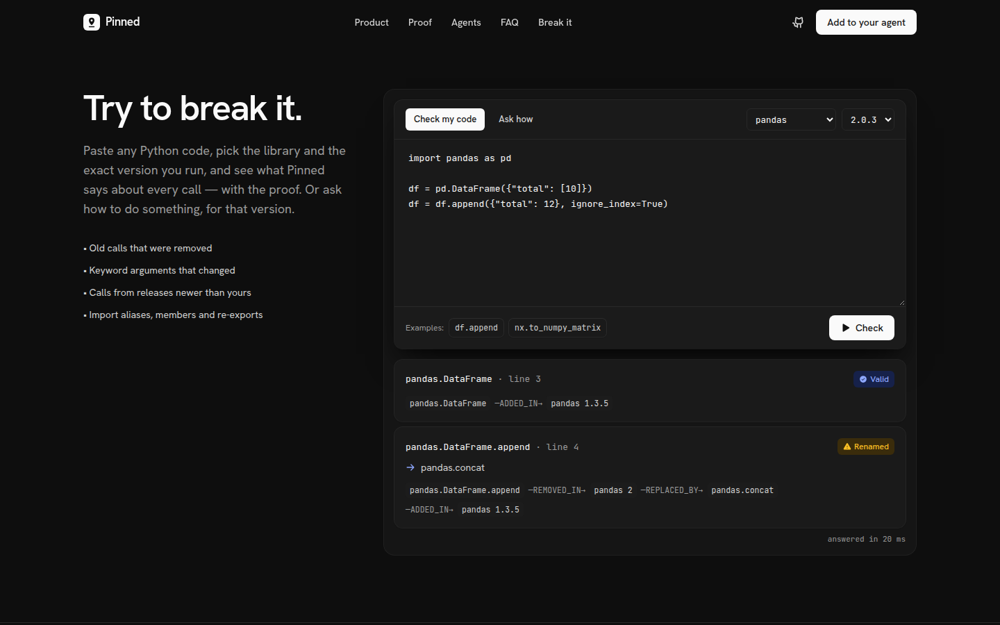
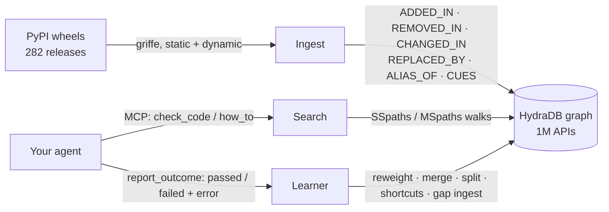

<div align="center">



# Pinned

**Code that runs on the version you actually have.**

Your coding agent learned from whatever docs were newest. Pinned checks its code against the exact library versions
you run, hands it the right call when an API changed — with the proof — and learns from every run.

[Live demo](https://3000-agqwsud3k4vlguzsgfducr6rfq.instabox.tech) · [Add to your agent](#add-it-to-your-agent) · [Results](#results) · [How it works](#how-it-works) · [HACKATHON.md](HACKATHON.md)

</div>

---

## Why

Ask an agent for pandas code and it may write `df.append(row)` — removed in pandas 2.0. Ask for scikit-learn and it may
call `load_boston` — removed in 1.2. The model is not wrong in general; it is wrong **for your version**, and nothing in
its loop knows which version you pinned.

Pinned is a version-aware map of every public API of 26 popular Python libraries across **282 releases**
(**1,012,306 APIs**), stored as a graph in [HydraDB](https://github.com/hydra-db/hydradb). Your agent asks it two
questions:

- **"Is this code valid for `pandas==2.0.3`?"** → every call, checked at that exact version, with a fix and the proof.
- **"How do I do X on `numpy 1.26`?"** → the calls that exist in *your* version, ranked, with their signatures.

```text
pandas.DataFrame.append  —REMOVED_IN→  pandas 2.0.0
pandas.DataFrame.append  —REPLACED_BY→ pandas.concat   (from pandas' own deprecation warning)
pandas.concat            → valid in 2.0.3, signature concat(objs, *, axis=0, join='outer', …)
```



## Add it to your agent

Pinned is an MCP server. No model inside, no API key: your agent does the thinking; Pinned answers from the graph.

**Hosted** (the live instance):

```bash
claude mcp add --transport http pinned https://3000-agqwsud3k4vlguzsgfducr6rfq.instabox.tech/mcp        # Claude Code
codex mcp add pinned --url https://3000-agqwsud3k4vlguzsgfducr6rfq.instabox.tech/mcp                    # Codex
```
Cursor: `{ "mcpServers": { "pinned": { "url": "https://3000-agqwsud3k4vlguzsgfducr6rfq.instabox.tech/mcp" } } }` in `.cursor/mcp.json`.

**Fully local** (your laptop, your graph):

```bash
git clone https://github.com/rohit-jsfreaky/pinned && cd pinned && uv sync
# get the ready-made graph (26 libraries, 282 versions) instead of ingesting for hours
git fetch origin graph-snapshot && mkdir -p data/snap && git --work-tree=data/snap checkout origin/graph-snapshot -- . && git reset -q
cat data/snap/pinned-graph.tgz.part-* > data/pinned-graph.tgz && sha256sum -c <(echo "aced2bde35f64d22a8b50856b7ee196ab56da5a53f071cd07951642259ac84f5  data/pinned-graph.tgz")
infra/hydradb-snapshot.sh load data/pinned-graph.tgz pinned 8443 7687 9090

claude mcp add --env HYDRA_URL=http://127.0.0.1:8443 --transport stdio pinned -- uv --directory "$PWD" run pinned mcp
```

Tools your agent gets: `check_code`, `how_to`, `explain_api`, `report_outcome`. There is also a CLI
(`pinned check file.py --lib pandas --version 2.0.3`, `pinned how "…"`, `pinned explain pandas pandas.DataFrame.append`)
and an HTTP API (`/v1/check`, `/v1/how`, `/v1/api/{lib}/{path}`, `/v1/outcome`, `/v1/libraries`, `/v1/stats`).

## Live demo



**Try to break it:** paste any Python code, pick a library and version, and see what Pinned says about every call.

## Results

Measured on [GitChameleon 2.0](https://arxiv.org/abs/2507.12367) (ACL 2026): 328 real coding tasks, each pinned to a
real library release and scored by hidden tests. Split 50/50 per library (seed 13); Pinned learns only from the 159
training tasks; **every number is on the 169 held-out tasks**. Same model for every arm (`claude -p --model haiku`),
same prompt template, one sample per task. Every number links to a saved run in [`evidence/`](evidence/).

| arm | pass@1 | wrong-version API errors¹ |
|---|---|---|
| agent alone | 62.7% (106/169) | 15 |
| agent + the task's official docs | 67.5% (114/169) | 13 |
| **agent + Pinned (static graph)** | **66.9% (113/169)** | **9** |
| agent + Pinned after learning round 1 | 64.5% (109/169) | 9 |
| agent + Pinned after learning round 2 | 67.5% (114/169) | 7 |
| control: random valid APIs from the graph | 68.6% (116/169) | 9 |

¹ failures with `AttributeError`, `ImportError`/`ModuleNotFoundError` or `TypeError` — the errors a wrong-version call
produces.

**What this shows, honestly:**
- Pinned **cuts wrong-version API errors by 40%** (15 → 9) and to 7 after learning. That is the job it was built for.
- **pass@1 does not beat plain docs.** Most remaining failures (35 of 56) are code that runs but computes the wrong
  thing — not a version problem.
- **The learning curve is flat so far** (66.9% → 64.5% → 67.5%). 23 of the 169 tasks flip between identical runs, so
  one-sample differences of ±5 tasks are noise. The control that gives the agent *random* APIs valid at that version
  does as well — the version-valid API list helps; the learned ranking does not add yet.
- Making learning produce a rising curve (repeated samples, a check-then-fix loop, sharper learned cues) is the next step.

Learning did change the graph: 17,253 logged moves in round 1–2 — 12,196 entity merges, 2,635 edge reweights,
2,089 learned cues, 6 path-compression shortcuts ([`evidence/learn/`](evidence/learn/)).

**Speed on the full 1M-API graph** (one 4-vCPU box, [`evidence/search/latency-real.json`](evidence/search/latency-real.json)):
`check_calls` p50 **8.6 ms** (85 qps) at 1 client, 26 ms at 8 clients; `how_to` p50 172 ms, ~5 graph round trips per
answer, 0 errors under 32 concurrent clients.

## How it works



- **The graph** — `Library → Version`, `Api —ADDED_IN/REMOVED_IN/CHANGED_IN→ Version`, `Api —REPLACED_BY/ALIAS_OF→ Api`,
  `Term —CUES/SHORTCUT→ Api`. An API is valid at version *v* when its latest add/remove event at or before *v* is an add.
- **Search** walks `REPLACED_BY`/`ALIAS_OF` with HydraDB's path procedures (`algo.SSpaths`, `algo.MSpaths`) from any
  call that is not valid at your version to the nearest one that is, and returns that walk as the proof.
- **Learning** — every reported outcome reweights the edges behind the answer, adds learned cues, fills gaps by
  re-reading the named module from the real library, merges duplicate entities, splits per-version behaviour, and
  compresses chains that keep working into direct shortcuts. Learning never sees the held-out tasks or the answer key.

The graph is the work here: replacement chains are multi-hop walks across versions and types, which a flat key-value
store cannot answer. HydraDB limits we hit — and the workarounds — are in [HACKATHON.md](HACKATHON.md#hydradb-findings).

## Repository

| path | what |
|---|---|
| `src/pinned/graph/` | HydraDB client + batched, idempotent graph helpers |
| `src/pinned/ingest/` | PyPI → version graph (ladders, griffe, diffs, gap fill) |
| `src/pinned/search/` | `context_for`, `check_calls`, `explain_api` |
| `src/pinned/learn/` | the learner, plain-store ablation, shuffled control |
| `src/pinned/eval/` | GitChameleon harness: split, venvs, runner, solver, curve |
| `src/pinned/server/`, `src/pinned/cli.py` | HTTP API, MCP server, CLI |
| `web/` | the website |
| `evidence/` | every number above, as saved runs |

```bash
uv run pytest -q   # 235 tests; graph tests start a throwaway HydraDB node in Docker
```

## License

MIT
